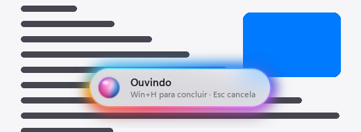
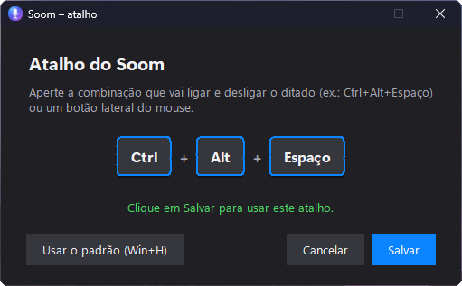

<div align="center">

# Soom

**Ditado por voz com IA para o Windows — 100% local, grátis e open source.**

Fale normalmente e o texto aparece, já pontuado, em qualquer lugar onde dá para digitar.


### [⬇️ Baixar o Soom para Windows](https://github.com/VitorFelipeCarneiro/soom/releases/latest/download/Soom-instalador.zip)

<sub>Windows 10 ou 11 · ~4 GB livres · funciona com placa de vídeo AMD, NVIDIA, Intel ou só com o processador</sub>

</div>

---

## Por que o Soom existe

O ditado que vem no Windows (**Win+H**) erra muitas palavras, quase não põe pontuação e se
perde quando você faz uma pausa para pensar. Já o ditado dos assistentes de IA, como os chats
de inteligência artificial, entende muito bem a fala, sabe onde vai vírgula e ponto final e lida
bem com pausas — mas só funciona dentro do próprio chat.

O Soom leva esse ditado de IA para **qualquer campo de texto do Windows**: WhatsApp, navegador,
Word, e-mail, Discord, o que for. E faz isso **inteiramente no seu computador**: o áudio nunca
sai da sua máquina, não precisa de conta, de assinatura nem de internet (depois de instalado).

## O que ele faz

- 🎙️ **Aperta Win+H, fala, aperta Win+H de novo.** O Soom assume o atalho do ditado do Windows.
- ✍️ **O texto aparece no campo enquanto você fala**, letra a letra, e a IA vai corrigindo
  conforme entende melhor a frase. Ao terminar, a revisão final é instantânea.
- 🧠 **Pontuação e pausas como num chat de IA**, graças ao modelo Whisper large-v3-turbo.
- 🔵 **Indicador estilo Siri:** uma cápsula de vidro com luz colorida que reage à sua voz. Dá para
  arrastar para qualquer lugar da tela.
- ⌨️ **Atalho do jeito que você quiser:** qualquer combinação de teclas ou um botão lateral do mouse.
- ↩️ **Enter no meio do ditado** termina, completa o texto e envia — ótimo para chats.
- 🔒 **Privado:** depois de baixar o modelo de voz, nada sai do seu computador.
- 🚀 **Abre junto com o Windows** e fica quietinho perto do relógio até você precisar.

<p align="center">
  
  
</p>

## Como instalar

1. **[Baixe o `Soom-instalador.zip`](https://github.com/VitorFelipeCarneiro/soom/releases/latest/download/Soom-instalador.zip)**
   (ou vá em [Releases](https://github.com/VitorFelipeCarneiro/soom/releases/latest)).
2. Clique com o botão direito no arquivo baixado → **Extrair tudo...** → **Extrair**.
3. Na pasta extraída, dê **dois cliques em `Instalar.cmd`**.
   - Se o Windows mostrar um aviso de segurança ("o editor não pôde ser verificado"), clique em
     **Executar**. Se aparecer "O Windows protegeu o computador", clique em
     **Mais informações → Executar assim mesmo**. Isso acontece com qualquer programa baixado da
     internet que não é vendido numa loja; o código do Soom está todo aqui para quem quiser conferir.
4. Espere terminar. Na primeira vez, o instalador baixa o **modelo de voz (~3 GB)**, então pode
   levar alguns minutos, dependendo da sua internet.
5. Pronto! O Soom já fica aberto (ícone perto do relógio) e vai abrir sozinho junto com o Windows.

O instalador cuida de tudo: instala o Python 3.12 se faltar (pelo winget, da python.org), copia o
Soom para `%LOCALAPPDATA%\Soom`, prepara as bibliotecas, baixa o modelo, cria o atalho no Menu
Iniciar e liga o início automático. Nada é instalado para outros usuários do computador.

> **Não quer que ele abra junto com o Windows?** Dá para desligar a qualquer momento no menu do
> ícone (**Iniciar com o Windows**).

## Como usar

1. Clique no campo onde quer escrever.
2. Aperte **Win+H**: toca um bipe e aparece o indicador **"Ouvindo"**.
3. Fale normalmente, com pausas. O texto vai sendo escrito direto no campo.
4. Aperte **Win+H** de novo para terminar.

| Durante o ditado | O que acontece |
|---|---|
| **Enter** | Termina, completa o texto e envia |
| **Esc** | Cancela e apaga o que o ditado escreveu |
| Clicar, digitar ou trocar de janela | O Soom para de escrever na hora (como o Win+H do Windows), para nunca mexer no lugar errado; o texto completo fica copiado para colar com Ctrl+V |
| Arrastar o indicador | Muda ele de lugar (a posição fica salva); duplo clique o devolve ao lugar padrão |

## O ícone do Soom (perto do relógio)

A cor mostra o estado: azul/roxo = pronto, rosa = ouvindo, âmbar = escrevendo, azul claro =
carregando. Clique com o **botão direito** para o menu:

| Opção | O que faz |
|---|---|
| **Trocar atalho...** | Abre uma janelinha: aperte a combinação que quiser (ex.: Ctrl+Alt+Espaço, F9, Win+Shift+D) ou um botão lateral do mouse e clique em Salvar |
| **Iniciar com o Windows** | Liga/desliga abrir junto com o Windows (vem ligado) |
| **Voltar o indicador ao lugar padrão** | Se você arrastou o indicador para outro canto |
| **Avançado** | Configurações avançadas e reiniciar o Soom |
| **Sair do Soom** | Desliga o Soom por completo — o Win+H volta a ser o do Windows |

<p align="center"></p>

## Como funciona por dentro (do que o Soom é feito)

O Soom é um programa em **Python** que junta peças open source:

| Peça | Papel |
|---|---|
| **[Whisper large-v3-turbo](https://huggingface.co/openai/whisper-large-v3-turbo)** (OpenAI, licença MIT) | O modelo de IA que transforma fala em texto pontuado. É o mesmo tipo de tecnologia usado nos ditados dos chats de IA |
| **[ONNX Runtime](https://onnxruntime.ai) + DirectML** (Microsoft) | Roda o modelo na sua placa de vídeo, seja ela AMD, NVIDIA ou Intel; sem placa, usa o processador |
| **[onnx-asr](https://github.com/istupakov/onnx-asr)** | Faz a ponte entre o modelo (exportado pela [onnx-community](https://huggingface.co/onnx-community/whisper-large-v3-turbo)) e o ONNX Runtime |
| **sounddevice, numpy, Pillow, pystray** | Microfone, tratamento do áudio, o desenho do indicador e o ícone perto do relógio |
| **API do Windows** (via ctypes) | O atalho global, a digitação no campo e a janela translúcida do indicador |

O caminho de uma frase:

1. **Atalho:** um "gancho" de teclado do Windows percebe o Win+H em qualquer programa e o
   segura, para o ditado do Windows não abrir.
2. **Microfone:** o áudio é gravado a 16 kHz, só enquanto você está ditando.
3. **Prévia ao vivo:** a cada ~1 segundo, o trecho em aberto da fala é transcrito de novo pelo
   Whisper na sua placa de vídeo. Trechos longos são "confirmados" nas pausas, e as revisões
   seguem rápidas mesmo em ditados de vários minutos.
4. **Texto no campo:** o texto é digitado no campo como se viesse do teclado, letra a letra. Quando
   a IA muda de ideia sobre uma palavra, o Soom apaga só o necessário e reescreve.
5. **Final:** ao terminar, se nada foi dito depois da última prévia, o texto já está pronto na
   hora; se não, a última parte é revisada (1 a 2 segundos).

Tudo isso acontece no seu computador. A única vez que o Soom usa a internet é para baixar o
modelo de voz na instalação.

## Privacidade

- O áudio e o texto **nunca saem do seu computador**.
- Não há contas, anúncios, telemetria nem coleta de dados.
- O arquivo de registro (`soom.log`) guarda só tempos e tamanhos, **nunca o que você ditou**.

## Requisitos

- Windows 10 ou 11 (64 bits)
- ~4 GB livres (o modelo de voz tem ~3 GB)
- Microfone
- Placa de vídeo recomendada (AMD, NVIDIA ou Intel). Sem ela funciona pelo processador, mais devagar
  — nesse caso, use `"quantizacao": "int8"` e `"previa": "desligada"` nas configurações avançadas.

## Configurações avançadas (`config.json`)

No menu do ícone → **Avançado → Configurações avançadas**. Depois de salvar, use **Reiniciar o Soom**.

| Opção | O que faz |
|---|---|
| `atalho` | Atalho de liga/desliga (ex.: `"win+h"`, `"ctrl+alt+space"`, `"f9"`) — mais fácil trocar pelo menu |
| `botao_mouse` | Liga/desliga com um botão do mouse: `"lateral1"`, `"lateral2"`, `"meio"` ou `null` |
| `idioma` | `"pt"` (português). Use `null` para detectar o idioma sozinho, ou outro código (`"en"`, `"es"`...) |
| `modelo` | Modelo do Hugging Face. Padrão: `onnx-community/whisper-large-v3-turbo` |
| `quantizacao` | `null` (melhor qualidade, ideal para placa de vídeo) ou `"int8"` (mais leve, para quem só tem processador) |
| `usar_gpu` | `true` usa a placa de vídeo; `false` força o processador |
| `microfone` | `null` = microfone padrão do Windows, ou parte do nome do microfone |
| `espaco_no_final` | Põe um espaço depois do texto, para emendar o próximo ditado |
| `restaurar_area_de_transferencia` | Devolve o que estava copiado depois de colar o ditado |
| `esc_cancela` | Esc cancela o ditado |
| `sons` | Bipes de início e fim |
| `mostrar_indicador` | Mostra o indicador "Ouvindo" na tela |
| `previa` | `"no_campo"` (o texto aparece direto no campo), `"na_caixinha"` (aparece no indicador e é colado no final) ou `"desligada"` |
| `posicao_indicador` | Onde o indicador fica (salvo quando você o arrasta). `null` = acima da barra de tarefas |
| `iniciar_com_windows` | Abrir junto com o Windows |
| `duracao_maxima_segundos` | Para sozinho depois desse tempo (se esquecer o microfone ligado) |

## Limitações conhecidas

- Programas abertos **como administrador** não aceitam texto de um programa comum (proteção do
  Windows).
- Como o texto é digitado como se viesse do teclado, apps com autocompletar agressivo (alguns
  editores de código) podem reagir a ele; nesses casos use `"previa": "na_caixinha"`.
- Com um jogo pesado usando a placa de vídeo, o ditado fica mais lento.

## Desinstalar

Dois cliques em **`Desinstalar.cmd`** (na pasta que você baixou ou em `%LOCALAPPDATA%\Soom\app`).
Ele fecha o Soom, tira do início automático e do Menu Iniciar e apaga `%LOCALAPPDATA%\Soom`.
O modelo de voz (~3 GB) fica guardado, para reinstalar rápido; para apagá-lo também:

```powershell
powershell -ExecutionPolicy Bypass -File .\desinstalar.ps1 -RemoverModelo
```

## Onde fica cada coisa

| O quê | Onde |
|---|---|
| O programa instalado | `%LOCALAPPDATA%\Soom\app` |
| Configurações (`config.json`) e registro (`soom.log`) | `%LOCALAPPDATA%\Soom` |
| Python do app | `%LOCALAPPDATA%\Soom\venv` |
| Modelo de voz | `%USERPROFILE%\.cache\huggingface` |

## Para desenvolvedores

O código fica em [`soom/`](soom), um módulo por assunto:

| Módulo | O que faz |
|---|---|
| `app.py` | O "maestro": liga atalho, microfone, modelo, prévia, indicador e ícone |
| `speech.py` | O modelo de voz (Whisper via ONNX Runtime) e a prévia ao vivo |
| `output.py` | Como o texto chega ao campo (digitado ao vivo ou colado) |
| `overlay.py` | O indicador de vidro com a luz estilo Siri (desenhado em numpy, ~2 ms por quadro) |
| `hotkeys.py` | Atalho global, captura de atalho novo e vigilância de cliques/teclas |
| `shortcut.py` | A janelinha de trocar o atalho |
| `startup.py` | Iniciar junto com o Windows |
| `audio.py` | Microfone, sons e tratamento do áudio |
| `text.py` | Regras de texto (juntar pedaços, filtrar "alucinações" do Whisper) |
| `tray.py` | O ícone perto do relógio |
| `config.py` | Caminhos, opções e registro |
| `win32.py` | Acesso às funções do Windows |

Depois de instalar, dá para rodar direto da pasta do código:

```powershell
& "$env:LOCALAPPDATA\Soom\venv\Scripts\pythonw.exe" Soom.pyw
```

Testes (feche o Soom antes do `test_modelo.py`, que usa a placa de vídeo):

```powershell
$py = "$env:LOCALAPPDATA\Soom\venv\Scripts\python.exe"
& $py tests\test_logica.py      # lógica (segundos)
& $py tests\test_indicador.py   # desenho, janela e arrastar (segundos)
& $py tests\test_modelo.py      # modelo de voz de verdade (~1 minuto)
```

## Licença

[MIT](LICENSE) — use, modifique e distribua à vontade, mantendo o aviso de direitos autorais.
O modelo Whisper é da OpenAI, também sob licença MIT.
